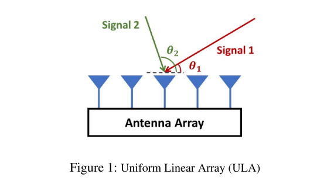
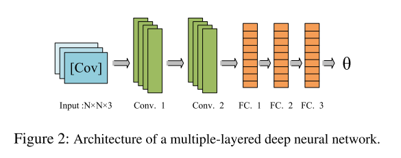
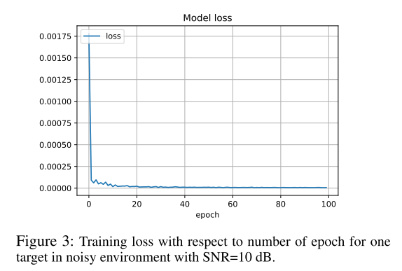
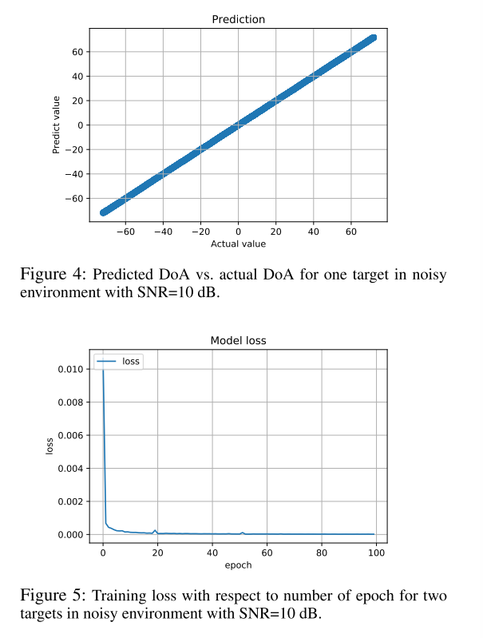
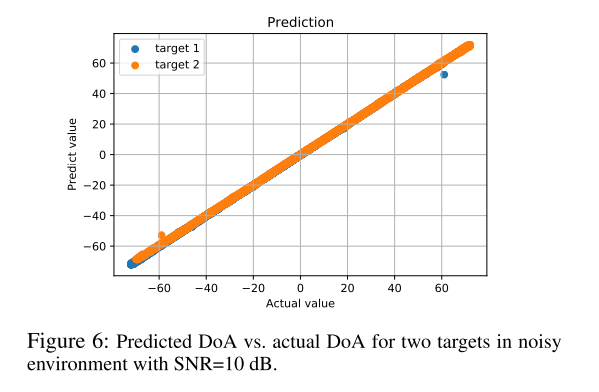
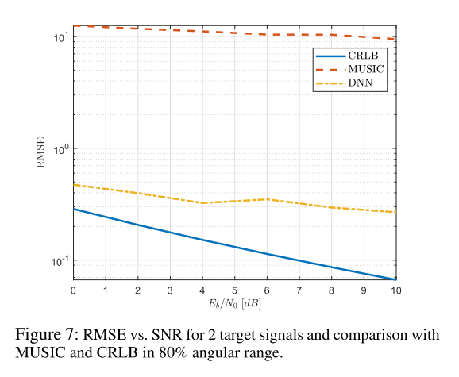

# Deep Learning + DOA: Wireless Communication Signal Direction Estimation Based on Deep Neural Networks [with MATLAB Code]

Introduction: Due to various applications of direction of arrival (DoA) estimation, including tracking, positioning, and gesture recognition, researchers have considered it for decades. One requirement of DoA estimation is the use of an antenna array consisting of individual components arranged in a specific mapping. Some applications, such as vehicles, ships, aircraft, and base stations, utilize these types of antennas. They play a significant role in enhancing channel capacity. "Due to their ability to redirect zero signals and beams to minimize interference and maximize gain at specific directions, as well as their predictive capability of received signal arrival angles, they are attractive for mobile wireless communications. DoA estimation has a long history and numerous technical and algorithmic approaches. Enhancing accuracy and super-resolution, and adaptability to challenging scenarios with minimal snapshots and low Signal-to-Noise Ratio (SNR), are hot topics in DoA estimation (Guo et al., 2020; Mecklenbräauker et al., 2020; Zhou et al., 2020; Papageorgiou, Sellathurai, and Eldar, 2020; Zhu et al., 2020; Chen, Gong, and Mao, 2020).
Classical methods can be divided into the following categories: subspace-based methods (Gupta, Aditya, and Datta 2016), multi-signal classification (MUSIC), estimation of signal parameters via rotation-invariant techniques (ESPRIT), beamforming techniques (Krishnaveni, Kesavamurthy, and Aparna 2013), and maximum likelihood methods (Mecklenbrüauker and Gerstoft 2019). These techniques map from signal direction to array output, and vice versa. The precision of these methods depends on the mapping accuracy. However, since most system deficiencies may arise due to non-ideal sensor design and development, array assembly, interference, and background radiation are non-ideal.
Recently, researchers have begun using frameworks equipped with machine learning technology to estimate the direction of arrival (DoA) of signals. These methods are data-driven and do not rely on the assumption of an ideal array. They create training datasets with DoA labels and then use machine learning techniques to extract a mapping between outputs and signal directions. In our work, leveraging deep neural network technology, we propose and implement a DoA estimation method. Our goal is to improve the prediction accuracy of DoA compared to other powerful classical and theoretical methods, such as MUSIC and Cramer-Rao Lower Bound (CRLB). Additionally, we compare the performance of this method in both noisy and noise-free environments.
There are numerous works in the literature that utilize machine learning algorithms for DoA estimation. In this paper, we examine the literature on DoA estimation based on deep neural networks.
One of the most promising DoA prediction methods recently is neural networks and deep learning algorithms, which have attracted much attention (Takeda and Komatani 2016; Adavanne, Politis and Virtanen 2018). These papers develop a deep learning method for DoA estimation in microphone arrays using the time-frequency image of the signal as input. In these two papers, the source angle resolution is quite coarse, at 5 μ m (Takeda and Komatani 2016) and 10 μ m (Adavanne, Politis and Virtanen 2018). In (Chen, Gong and Mao 2020), the authors describe an approach to integrate detection with DoA estimation based on a deep neural network (DNN). They divide the DoA estimation network into multiple DNNs to minimize the necessary training data. Finally, they run an offline training phase to reduce the computational time for signal direction estimation. Additionally, in (Baig and Malik 2013), the authors provide a comprehensive study on array processing and describe various beamforming methods. They follow their advantages in communication systems. Moreover, they explain different DoA estimation methods, including spectral estimation, minimum variance uncorrelated linear estimate (MVLLE), linear prediction, maximum entropy, maximum likelihood (ML), MUSIC, ESPRIT, and compare their performances.
In (Papageorgiou, Sellathurai, and Eldar 2020), the authors implemented a deep convolutional neural network (CNN) for DoA estimation in low SNR scenarios. They treated DoA estimation as a multi-label classification problem, extracting features from multi-channel input data through convolutional layers. Subsequently, their proposed method could infer the number of sources. Then, the fully connected layer derived DoA using the output of the convolutional layer. Based on the root mean square error (RMSE), their method performed well in the low SNR region. Additionally, their angle estimation was sufficient within a resolution of 1.
In (Zhu et al. 2020), the authors proposed ensemble learning to reduce processing time. They used five different CNNs independently to determine the azimuth and elevation angles. To perform 2D DoA estimation, they considered an uniform circular array (UCA) in the model. Moreover, in each CNN, the input to the CNN was the spatial covariance matrix of the received signal, and their output led to the final predictions of azimuth and elevation angles. Furthermore, their method could estimate DoA immediately suitable for real-time applications. In (Liu, Zhang, and Philip 2018), the authors used DNN methods to improve the accuracy of DoA estimation in actual sensor arrays. Additionally, they considered array defect effects in the model. Then, they used preprocessing methods such as spatial filters to reduce the distribution difference of the input data. For this purpose, their DNN framework included a multi-task autoencoder as a preprocessing filter to denoise the DNN inputs and some parallel multiple-layer classifiers. Finally, they compared their proposed model with methods based on SVR and MUSIC to show its performance comparable to other methods (such as MUSIC).
Additionally, Kaser et al. (2018) proposed a deep neural network with four layers of fully connected (FC) layers to estimate the direction of arrival (DoA) using the signal covariance matrix. In (Wu, Liu, and Huang 2019), the authors introduced a deep convolutional network framework with four convolutional layers that can effectively obtain DoA estimates in near real-time.
Article illustrations
Conclusion: This paper investigates the performance of using deep neural networks for DoA estimation in both single-signal space and dual-signal space. To this end, we generated extensive simulated data. Subsequently, by utilizing the simulation dataset within the training cycle, we employed the learned multilayer neural network to perform direction finding estimation on the signals. The results and evaluation metrics demonstrate the performance of our framework. Further research was conducted on the impact of antenna array design parameters on DoA estimation accuracy. The findings indicate that the more antenna elements there are, the smaller the root mean square error is. More practically, an antenna array is designed based on the size and application of the antenna elements to have the maximum allowable number of antenna elements. Additionally, we investigated the impact of different angle ranges on DoA estimation accuracy and showed that DoA estimation with narrower angle ranges has better performance compared to full angle ranges.
Furthermore, we compared our framework with other commonly used DoA estimation methods such as MUSIC using the Cramer-Rao Lower Bound (CRLB) as the benchmark for our method. In this comparison, we observed that the proposed DNN-based estimation performed better than other classical methods.

## Images

<!-- PAYMENT_BLOCK -->

## Get this dataset

- Payment link (Stripe): [Buy now](https://buy.stripe.com/3cs8yP7sY87d0vu9AB)
- Payment QR code: 

<!-- /PAYMENT_BLOCK -->
